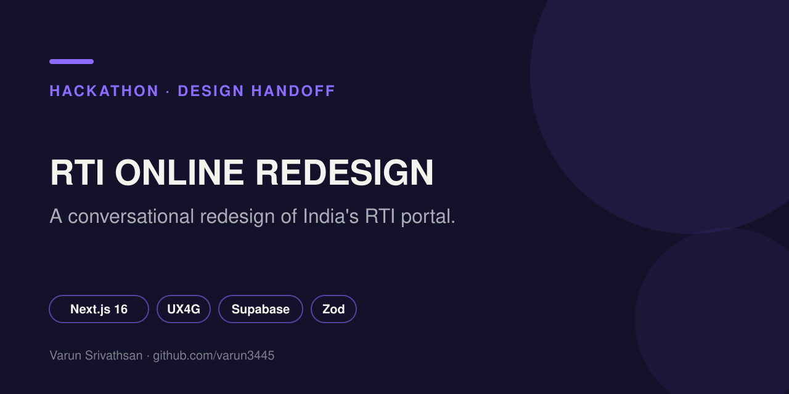

<p align="center"></p>

# RTI Online Redesign

A citizen facing redesign of [RTI Online](https://rtionline.gov.in), built for the Build What Moves India hackathon.

   

## The idea

Two changes to how people file Right to Information requests:

1. **A conversational composer** replaces the multi field form. You describe what you want to know and the app drafts the request.
2. **A unified case tracker** collapses multi department fragmentation. On the live site one request can silently split into several sub registration numbers. Here it stays one plain language view.

## Design system

Built on **UX4G**, MeitY's published design system (`ux4g-web-components`), extended rather than replaced. Spacing, type scale, radius, shadow and blur all come from UX4G tokens. There are two disclosed exceptions: a display typeface for marketing headlines and a depth and motion layer. The full token table, component list, edge cases and accessibility notes are in [`DESIGN_HANDOFF.md`](DESIGN_HANDOFF.md).

## Pages

Home (multi step: home, chat, verify, pay, done), How it works, Your rights, FAQ, My RTI dashboard, View status, View history, Contact, Policy, Manual.

## Accessibility

- Skip link and a persistent text size control (A-, A, A+).
- Token based type scale with no raw pixel font sizes.
- Contrast values checked and recorded in the handoff spec.

## Stack

Next.js 16 (App Router), React 19, TypeScript, Tailwind CSS 4, Supabase, Zod for validation, Lucide icons.

## Run it locally

```bash
cp .env.local.example .env.local   # add your Supabase values
npm install
npm run dev
npm run verify:cases               # sanity check on the case data
```

## Author

[Varun Srivathsan](https://varunsrivathsan.com).
